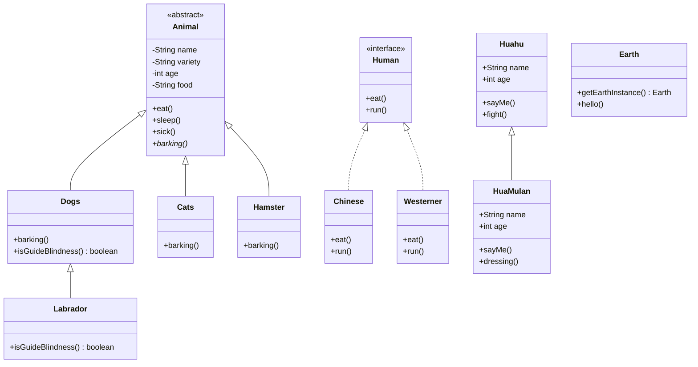

# dogs_managerment

**一个 Java 面向对象编程的学习示例集** —— 封装、继承、多态、抽象类与接口、`static` / `final`、单例模式，每个知识点配一个小例子。

<p align="center">
  
  
  
  
</p>

仓库名沿用第一次建项目时起的 `dogs_managerment`，内容却远不止“狗狗管理”——它更像是我学 Java 面向对象时的一个练习本：每个类讲清一个知识点，代码里保留着当时写的注释和思考过程。适合刚接触 Java、或者准备复习 OOP 的同学对照阅读，也可以直接 clone 下来改成自己的练习模板。

## 内容一览

| 知识点 | 示例文件 | 说明 |
| --- | --- | --- |
| 封装 | [Animal.java](src/com/microsoft/bean/Animal.java) | 字段全部 `private`，通过 getter/setter 访问；`setAge` 会把 0–30 之外的输入清零并给出提示 |
| 抽象类 / 抽象方法 | [Animal.java](src/com/microsoft/bean/Animal.java) | `Animal` 是抽象类，`barking()` 是抽象方法，具体怎么叫交给子类决定 |
| 继承 | [Dogs.java](src/com/microsoft/bean/Dogs.java) · [Cats.java](src/com/microsoft/bean/Cats.java) · [Hamster.java](src/com/microsoft/bean/Hamster.java) · [Labrador.java](src/com/microsoft/bean/Labrador.java) | 狗、猫、仓鼠继承 `Animal`；拉布拉多再继承 `Dogs` |
| 方法重写 | [Dogs.java](src/com/microsoft/bean/Dogs.java) | `@Override barking()` → “汪汪！~~~~~~”；猫是“喵喵喵”，仓鼠是“吱吱吱” |
| 向上转型 | [Application.java](src/Application.java) | `Huahu huahu = new HuaMulan();` 用父类引用指向子类对象 |
| 向下转型 | [Application.java](src/Application.java) | `(HuaMulan) huahu` 转回子类后，调用子类独有的 `dressing()` |
| 接口 | [Human.java](src/com/microsoft/bean/Human.java) · [Chinese.java](src/com/microsoft/bean/Chinese.java) · [Westerner.java](src/com/microsoft/bean/Westerner.java) | `Human` 抽象“吃、跑”两种行为，两个实现类给出不同跑法 |
| static | [Animal.java](src/com/microsoft/bean/Animal.java) · [Huahu.java](src/com/microsoft/bean/Huahu.java) | 静态常量 `TEXT_COMMUNITY_NAME`、静态方法 `injection()` / `sayMe()` |
| final | [Labrador.java](src/com/microsoft/bean/Labrador.java) · [Animal.java](src/com/microsoft/bean/Animal.java) | `final class Labrador` 不能再被继承；`static final` 修饰常量 |
| 单例模式 | [Earth.java](src/com/microsoft/bean/Earth.java) | 饿汉式单例：私有构造器 + 静态实例 + `getEarthInstance()` |
| Lombok | [Animal.java](src/com/microsoft/bean/Animal.java) | `@Getter` / `@Setter` / `@ToString` 自动生成样板代码 |

## 项目结构

```
dogs_managerment/
├── src/
│   ├── Application.java                # 程序入口：向上转型 / 向下转型演示
│   └── com/microsoft/bean/
│       ├── Animal.java                 # 抽象类：封装、抽象方法、static、Lombok
│       ├── Dogs.java                   # 继承与方法重写，isGuideBlindness() 标注为“反例”
│       ├── Labrador.java               # final 类：拉布拉多，重写导盲判断
│       ├── Cats.java                   # 猫：重写 barking()
│       ├── Hamster.java                # 仓鼠：重写 barking()
│       ├── Human.java                  # 接口：对行为做抽象
│       ├── Chinese.java                # Human 实现类
│       ├── Westerner.java              # Human 实现类
│       ├── Huahu.java                  # 父类“花虎”，演示转型的父类型
│       ├── HuaMulan.java               # 子类“花木兰”，多了一个 dressing()
│       └── Earth.java                  # 单例模式示例
├── jar/
│   └── lombok-1.18.48.jar              # Lombok，随仓库提供，无需额外下载
├── .idea/                              # IntelliJ 工程配置（workspace.xml 等本机文件已忽略）
├── dogs_managerment.iml                # IntelliJ 模块配置（源码目录、Lombok 库）
├── LICENSE                             # MIT 许可证
└── .gitignore
```

> 编译输出目录 `out/` 会在运行后生成，已加入 `.gitignore`，不会提交到仓库。

## 类关系一览



## 环境要求

- **JDK 17 及以上**（本项目在 JDK 25 下开发）
- **IntelliJ IDEA**（推荐，社区版即可；Lombok 插件已内置）
- 不需要 Maven / Gradle：Lombok 以 jar 形式直接放在 `jar/` 目录里

## 快速开始

### 方式一：IntelliJ IDEA（推荐）

1. `git clone` 仓库，或用 GitHub 上的 **Download ZIP** 下载后解压。
2. IDEA → `File → Open`，选择项目根目录（包含 `src` 的那一层）。
3. 如果 IDEA 提示 Project SDK 未配置，在 `File → Project Structure → Project` 里选择本地 JDK 17+。
4. 打开 `src/Application.java`，点击 `main` 方法左侧的绿色三角运行。

项目自带 `.iml` 和 Lombok 库配置，通常不需要手动添加依赖。如果 Lombok 没有生效（比如提示找不到 `getName()`），请检查 `Settings → Build, Execution, Deployment → Compiler → Annotation Processors` 中是否勾选了 **Enable annotation processing**。

### 方式二：命令行

项目没有构建脚本，直接用 `javac` 编译即可。在项目根目录执行（PowerShell）：

```powershell
$sources = Get-ChildItem -Recurse -Path src -Filter *.java | ForEach-Object FullName
javac -encoding UTF-8 -proc:full -cp "jar/lombok-1.18.48.jar" -d out $sources
java -cp "out;jar/lombok-1.18.48.jar" Application
```

- JDK 21 及以上请保留 `-proc:full`（显式开启注解处理）；JDK 20 及以下不支持该参数，删掉即可（这些版本默认就会执行注解处理）。
- Windows 控制台如果中文乱码，先执行 `chcp 65001` 再运行。
- macOS / Linux 下 classpath 分隔符是冒号：`java -cp "out:jar/lombok-1.18.48.jar" Application`。

## 运行结果

运行 `Application.main` 后输出：

```
Huahu
60
大家好，我叫Huahu，我今年60！
干架！
HuaMulan
28
大家好，我叫HuaMulan，我今年28！
涂脂抹粉
```

## 代码导读

### 抽象类 vs 接口

`Animal` 用抽象类描述“动物是什么”：有名字、品种、年龄、食物这些共有的成员变量，也有已经写好的 `eat()`、`sleep()`，只把叫声 `barking()` 留给子类实现。

`Human` 则用接口描述“能做什么”：只有 `eat()`、`run()` 两个行为约定，`Chinese` 和 `Westerner` 各自实现。代码注释里也写了这个区别：抽象类针对具体事物，接口针对行为。

### 继承链：Animal → Dogs → Labrador

`Dogs`、`Cats`、`Hamster` 继承 `Animal`，重写 `barking()` 后各叫各的。`Dogs` 里的 `isGuideBlindness()` 被标注为“反例”：把“是否导盲”这种只属于部分狗的能力放在所有狗身上并不合适。`Labrador` 继承后重写为 `true`，同时用 `final` 声明，表示继承链到此为止。

### 多态：花虎与花木兰

`Application.main` 是唯一带 `main` 方法的入口，演示向上转型和向下转型：

```java
Huahu huahu = new HuaMulan();          // 向上转型：父类引用指向子类对象
// ...
HuaMulan huaMulan = (HuaMulan) huahu;  // 向下转型：转回子类
```

`HuaMulan` 继承 `Huahu`，并多了一个 `dressing()`（涂脂抹粉）。用父类引用时，只能访问父类里定义的东西；想调用子类独有的方法，必须先向下转型。

### 单例：Earth

`Earth` 把构造器设为 `private`，在类加载时创建唯一实例，对外只暴露 `getEarthInstance()`，是标准的饿汉式单例。可以这样使用：

```java
Earth.getEarthInstance().hello();
```

## 几个容易混淆的点

- **字段隐藏，而不是重写。** `HuaMulan` 里重新声明了 `name`、`age`，所以 `huahu.name` 打印的是父类的 `"Huahu"`、`huahu.age` 是 60。字段访问由引用类型决定，不会像方法那样动态绑定。
- **静态方法没有多态。** `huahu.sayMe()` 实际调用的是 `Huahu.sayMe()`，IDEA 会提示 *Static member accessed via instance reference*；`sayMe()`、`fight()`、`dressing()` 都是静态方法。真正体现多态的是实例方法，例如：

  ```java
  Animal animal = new Dogs("旺财", "金毛", 3, "狗粮");
  animal.barking();  // 汪汪！~~~~~~
  ```

- **手写方法会覆盖 Lombok 生成的。** `Animal` 上标了 `@Getter` / `@Setter`，但类里手写了 `getAge()` / `setAge()`，Lombok 会跳过已有方法，所以 `setAge` 里的数据校验才会生效。

## 说明与局限

- 这是学习笔记式的示例代码，不是可以直接用于业务的项目。`main` 只演示了多态部分，其余类需要自己写 `main` 或断点调试来观察运行效果。
- 保留了一些学习过程中的中间写法：例如 `Animal(String name, int age)` 目前还没有给字段赋值，`Dogs.isGuideBlindness()` 被标注为“反例”。这些地方正好可以当作练习，改成你认为合理的实现。
- 没有引入 Maven / Gradle，Lombok 直接以 jar 形式存放在仓库里，clone 后用 IDEA 打开即可运行。

## 参与贡献

- 发现代码问题，或者想补充一个知识点示例，欢迎提 Issue / PR。
- 如果这个仓库对你有帮助，可以 fork 一份当作自己的练习模板。

## 许可证

本项目采用 [MIT License](LICENSE) 开源，可以自由使用、修改和分发，保留版权声明即可。
